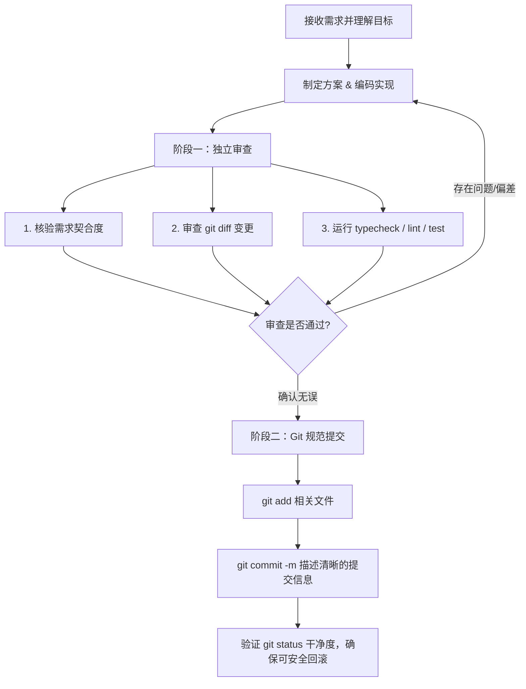

# Agent 工作规范与指南 (AGENTS.md)

本文档是本仓库中所有 AI Agent 及协作开发者的行为守则与操作规范。在进行任何代码修改、重构或功能开发时，必须严格遵守以下原则与工作流。

---

## 核心工作守则

### 1. 代码修改后独立审查（确保与目标一致）
每次完成代码修改或功能变更后，必须执行**独立审查**，严禁未经核实直接交付或标记完成：
- **目标一致性检查**：对照用户的原始诉求（User Request）与规划目标，逐项核对代码改动是否完全符合预期，杜绝偏差、遗漏或不必要的过度设计。
- **变更范围审查**：使用 `git diff` 仔细核对变更清单，确认每一处改动均在预期范围内，不存在意外删除、格式污染、残留的临时调试代码或敏感信息。
- **质量与功能验证**：
  - 静态类型检查：执行 `npm run typecheck`，确保 TypeScript 类型无报错。
  - 代码规范检查：执行 `npm run lint`，确保符合 ESLint 校验规则。
  - 测试验证：执行 `npm test`，确保既有测试与新编写的测试全部通过。
  - 交互/UI 验证（如涉及）：如改动涉及界面或交互逻辑，须确认页面渲染无视觉破损或异常报错。

### 2. 确认无误后 Git 提交（确保随时可安全回滚）
审查并确认代码与目标完全一致且验证通过后，必须使用 `git commit` 将改动持久化保存到版本控制中：
- **原子化提交 (Atomic Commits)**：每次提交仅包含一个独立、完整的改动逻辑，避免将多个不相关的修改混杂在一个庞大提交中。
- **规范的提交信息**：采用 Conventional Commits 规范清晰描述改动的类型与目的，例如：
  - `feat: <新功能描述>`
  - `fix: <问题修复描述>`
  - `refactor: <重构描述>`
  - `test: <测试用例添加或更新>`
  - `docs: <文档更新>`
  - `chore: <构建工具/依赖/配置调整>`
- **确保可回滚性**：保证每一个提交节点都是自包含且构建稳定的，一旦发现线上异常或需求调整，可随时通过 `git revert` 或 `git reset` 安全无缝地回滚至上一稳定状态。
- **仓库干净度保持**：提交前核对 `git status`，确保不必要的文件、临时生成物已被 `.gitignore` 过滤，避免误提杂质文件。

---

## 标准开发工作流

---

## 常用验证与操作命令

- **类型检查**：`npm run typecheck`
- **代码规范检查**：`npm run lint`
- **运行单元测试**：`npm test`
- **本地启动调试**：`npm run dev`
- **构建生产包**：`npm run build`
- **状态与差异核对**：
  - `git status`
  - `git diff`
- **版本提交**：
  - `git add <files>`
  - `git commit -m "<type>: <message>"`
