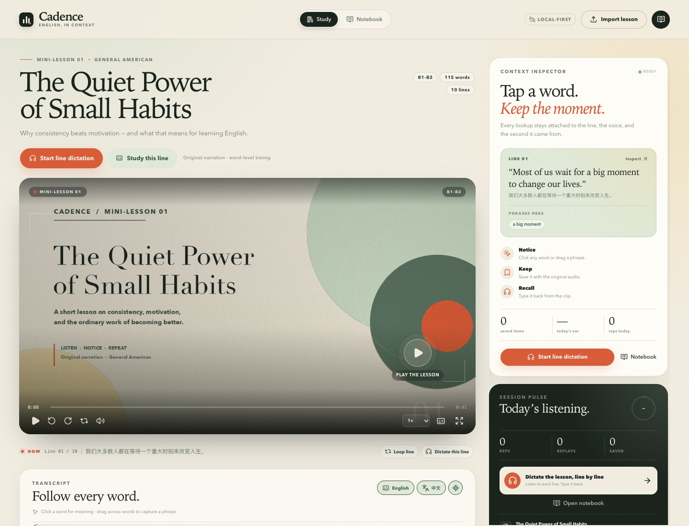
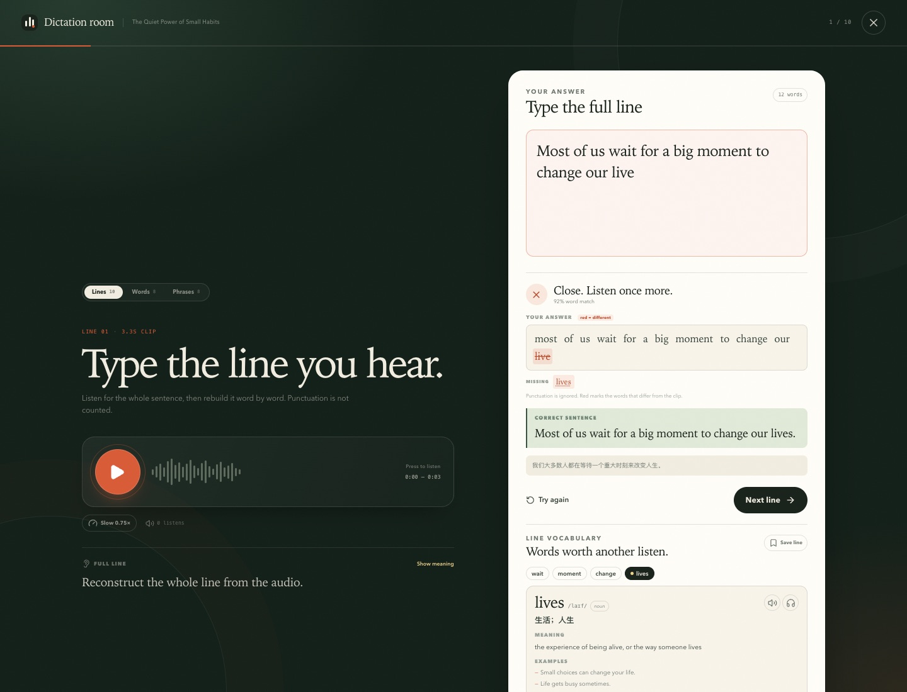
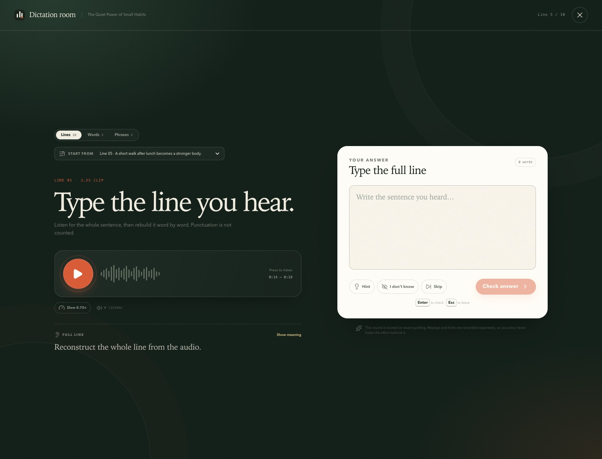
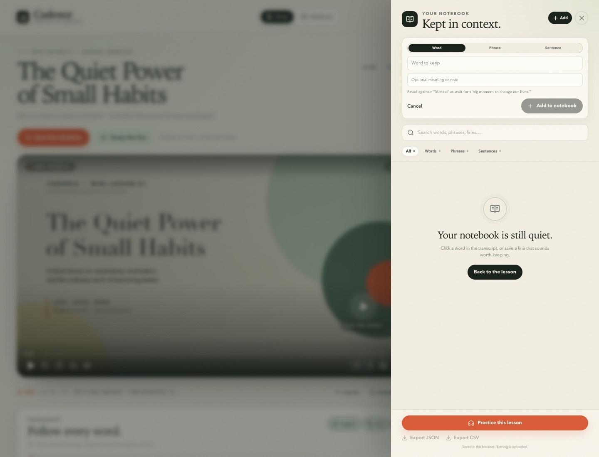
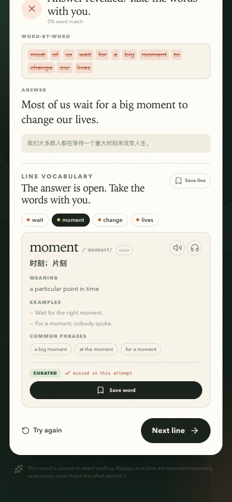

# Cadence：交互式视频英语学习平台
## 可行性评估、范围收敛与实现计划

**版本**：v1.1（逐句听写 + 单词本升级）  
**日期**：2026-10-18  
**当前状态**：第一阶段（交互字幕 + 逐句听写 MVP）已实现，可在本地运行  
**文档目的**：判断原方案是否值得做、哪些部分需要修正，并把修正后的产品拆成可交付、可验证的工程阶段。

---

## 0. 结论先行

### 0.1 总体判断

**值得做，技术可行性高，但“任意视频链接导入”不是第一版应该承诺的能力。**

这个项目真正的难点不在播放器，也不在字幕高亮，而在三件事：

1. **内容权利与来源**：能不能合法地拿到视频、音频和字幕，并在产品里使用。
2. **时间对齐质量**：句子级字幕不等于词级时间戳；没有音频就无法可靠恢复词边界。
3. **学习闭环是否真的成立**：用户是否愿意从“看视频”走到“听写、回忆、复习”，并在一周后回来。

原方案对这三点有清晰直觉，尤其是“Context First”“同一份字幕数据支撑观看与练习”“收藏必须能回到原视频时间点”。这些方向是正确的。需要修正的是**范围、依赖顺序和对 AI 的期待**。

### 0.2 对原方案的五个关键修正

| 原方案 | 修正建议 | 原因 |
|---|---|---|
| 第一版支持视频 URL 导入 | 第一版只支持**本地视频 + 用户自备 SRT/VTT**；URL/YouTube 作为第二适配器 | 平台条款、字幕下载权限、云端 IP 封锁和音频不可得，会把首版拖入不可控工程 |
| Next.js + FastAPI 全量前后端分离 | 先做 **Next.js 模块化单体 + 浏览器本地存储**；只把转录/对齐拆成 Python worker | 单人开发时，两个服务、两套鉴权、两套部署会显著增加维护成本 |
| 词级同步是“实现不难，难在数据” | 更准确地说：**有词级数据时实现简单；没有词级数据时，恢复词边界本身就是独立问题** | Forced Alignment 需要音频；仅靠逐字稿无法恢复时间 |
| 用 ts-fsrs 做个性化复习 | 先分清 **听辨、拼写、词义** 三种技能，再分别建 FSRS 卡 | 一个“熟练度”分数会把听错、拼错、理解错混在一起，后续无法解释和优化 |
| Free Dictionary API 作为词典方案 | 只作为英文兜底；中文释义需要**有明确许可的双语词典数据** | 该 API 主要是英文释义，中文、稳定性、调用限制和内容许可都不足以支撑正式产品 |

### 0.3 最适合的第一步

**把“同一段声音的观看 → 查词 → 收藏 → 听写 → 回到原处”做成一个完整、顺滑的闭环，而不是先接十个视频平台。**

当前实现已经完成这一步：

- 原创 41 秒英语视频，10 句、115 个词，带 ASR 推导的词级时间戳；
- 逐词高亮、句子跳转、循环、字幕开关、倍速；
- 点击单词、拖选短语、整句收藏，全部带原句与时间戳；
- **默认逐句听写**：按课程顺序连续听写 10 句，单词/短语作为强化模式；
- “I don’t know”揭示答案后自动展开逐句词表，接入免费公共词典、例句、短语与中文机翻速释；
- 单词级与句子级评分、漏词/多词 diff、重播与提示分别计数；
- 单词/短语/整句可从听写结果直接收藏；单词本支持手动添加、删除、JSON/CSV 导出；
- 本地视频 + SRT/VTT 导入，视频存 IndexedDB，学习条目存 localStorage；
- 桌面与移动端布局，移动端查词为底部抽屉。

实现细节与验收记录见第 5 节。

---

## 1. 可行性评估

### 1.1 产品可行性：高，但差异化不在“字幕高亮”

TED 官方已经提供带同步字幕、句子跳转的交互式逐字稿（[TED Help](https://help.ted.com/hc/en-us/articles/360018572954-How-do-I-find-transcripts-for-TED-and-TEDx-talks)）。因此“能高亮、能点句子”本身不是壁垒。

真正值得建立的产品差异是：

- **同一语境闭环**：查到的词、收藏的短语、做错的听写，都能一键回到原视频的同一秒。
- **主动输出**：不是看完就结束，而是隐藏答案、听原声、重建语言。
- **时间成本低**：5 分钟可以完成一个小循环，而不是要求用户先做一套完整课程。
- **复习有来源**：复习卡不是脱离语境的词表，而是“当时那句话、那个声音、那个时间点”。

这三点的组合比“AI 生成解释”更难被通用字幕工具替代。

### 1.2 技术可行性：分层看，不要用一个总分概括

原方案给出的 1–5 分方向大体合理，但建议把“能力”拆成“有数据”和“无数据”两种情况：

| 能力 | 难度 | 可行性 | 关键前提 |
|---|---:|---|---|
| 本地视频播放、进度、倍速、循环 | 2 | 高 | 浏览器媒体兼容性 |
| 用现成词级时间戳做 Karaoke | 1–2 | 高 | 数据已经对齐 |
| 只有句子级字幕时“估计”词级时间 | 3 | 中高 | 只能用线性/权重估计，必须标注 estimated |
| 从音频恢复词级边界（ASR/forced alignment） | 4 | 中高 | 需要音频、模型、算力、抽样质检 |
| 从任意 URL 自动拿到视频 + 字幕 | 5 | 低 | 平台条款、登录、地域、IP 封锁 |
| 点击查词 + 英文释义 | 2 | 高 | 词典接口稳定性 |
| 高质量中文释义 + 搭配 | 3–4 | 中 | 双语词典许可与数据清洗 |
| 词/短语/句子听写与评分 | 2 | 高 | 音频片段可播放、评分规则清晰 |
| 短语/习语自动识别 | 4 | 中 | 边界判定与误报；用户主动选择更可靠 |
| FSRS 调度 | 2 | 高 | 真正难的是“按技能建模”，不是算法调用 |
| 账户、同步、多端 | 3 | 中高 | 鉴权、存储、隐私、成本 |
| 个性化内容推荐 | 4 | 中 | 需要内容库、难度标注和行为数据 |

### 1.3 平台与内容可行性：这是最大风险

#### YouTube

- **可以**通过 [YouTube IFrame Player API](https://developers.google.com/youtube/iframe_api_reference) 嵌入播放、读取播放时间、跳转、暂停，从而驱动自己的字幕面板和片段循环。
- **不能**通过官方 `captions.download` 下载任意公开视频字幕。该接口要求调用者对视频有编辑权限（[官方文档](https://developers.google.com/youtube/v3/docs/captions/download)）。
- `youtube-transcript-api` 可以尝试获取公开字幕，但作者明确说明云厂商 IP 经常被封锁，静态代理也会被 ban（[README](https://github.com/jdepoix/youtube-transcript-api#working-around-ip-bans-requestblocked-or-ipblocked-exception)）。
- YouTube 开发者政策明确限制未经书面许可下载、导入、备份、缓存或存储其视听内容（[Developer Policies](https://developers.google.com/youtube/terms/developer-policies)）。

**结论**：第一版不要把产品可用性绑定在 YouTube 自动抓取上。可以后续做“官方 embed + 用户自备字幕”的适配器，但不能把“下载视频/音频再做 WhisperX”作为默认路径。

#### TED / 播客 / 课程视频

TED 的逐字稿和视频同样受版权保护。即使页面上能看到 transcript，也不等于可以批量抓取、缓存、再分发。最稳妥的路径是：

1. 用户上传自己有权处理的文件；
2. 平台与内容方签订许可；
3. 只嵌入官方播放器，不复制媒体；
4. 用户自备字幕，平台只做学习层。

#### 本地视频

这是第一版最合适的路径：用户自己拥有或已获授权的视频 + SRT/VTT。它同时解决播放、音频片段、隐私和版权四个问题。当前 MVP 即采用此路线。

### 1.4 开源项目调研的补充判断

| 项目 | 许可 | 可借鉴的部分 | 不建议直接做的事 |
|---|---|---|---|
| [asbplayer](https://github.com/asbplayer/asbplayer) | AGPL-3.0 | 字幕选择、句子循环、Anki 卡片、播放器交互 | 直接改造后提供网络服务；AGPL 对网络使用有源代码提供义务 |
| [LinguaMiner](https://github.com/thecopybookhare-cmd/lingua-miner) | MIT | 逐词字幕、点词/选短语、上下文卡片 | 它的产品重心是本地 mining，不是多用户 SaaS |
| [Ear2Finger](https://github.com/stephenyin/Ear2Finger) | MIT | React + FastAPI 结构、逐句听写、进度 | 音频下载方式不适合直接公开部署 |
| [LiTy](https://github.com/voidism/LiTy) | MIT | 听写评分、错误对比、统计 | 它是 Python 本地工具，不是完整 Web 产品 |
| [WhisperX](https://github.com/m-bain/whisperX) | BSD-2-Clause | ASR + 词级时间戳 + diarization | 不能在没有音频/授权时使用；需要 GPU/CPU 成本评估 |
| [ts-fsrs](https://github.com/open-spaced-repetition/ts-fsrs) | MIT | FSRS 调度 | 不能替代技能建模；不要把所有练习塞进一个卡 |
| [Free Dictionary API](https://github.com/meetDeveloper/freeDictionaryAPI) | GPL-3.0（代码） | 英文释义/音标/发音兜底 | 中文释义、SLA、调用限制不足；正式产品需另找双语数据 |
| [Wiktextract](https://github.com/tatuylonen/wiktextract) | 需逐项核对 | 从 Wiktionary 提取结构化词典 | Wiktionary 数据有 CC BY-SA 等署名/相同方式共享义务，不能直接当“免费无限制词典” |

**建议**：研究这些项目的交互与数据模型，但不要以 fork 一个现有项目作为主路径。当前 MVP 是独立实现，避免被 AGPL 或许可证边界绑住。

### 1.5 风险矩阵

| 风险 | 可能性 | 影响 | 缓解 |
|---|---|---|---|
| 第三方视频平台限制/条款 | 高 | 高 | 本地/授权内容优先；官方 embed；用户自备字幕；不做默认下载 |
| 字幕或视频版权 | 高 | 高 | 用户权利声明、内容下架机制、许可内容库、演示资产自制 |
| 词级对齐质量不稳定 | 中 | 高 | 保存 confidence；exact/estimated 明示；抽样 WER/边界误差；允许人工修正 |
| ASR/对齐成本过高 | 中 | 中 | 队列、缓存、按需转录、模型分级、只处理授权内容 |
| 中文词典数据不可用 | 中 | 高 | 早期只保证英文释义 + 语境翻译；正式版采购/授权双语词典 |
| 用户不从观看走到听写 | 中高 | 高 | 把听写入口放在当前句和时间轴旁；5 分钟小循环；首轮正反馈设计 |
| 复习模型把技能混在一起 | 高 | 中 | 听辨/拼写/词义分开记录，分别调度 |
| 本地存储配额/清空 | 中 | 中 | 明示本地存储；提供导出；正式版云同步 |
| 移动端媒体/自动播放限制 | 中 | 中 | 所有播放由用户手势触发；显示明确的播放失败提示 |
| 范围膨胀 | 高 | 高 | 以“单段视频闭环”为 gate，未通过不加平台 |

### 1.6 对“最大不确定性”的回答

原方案写得对：**最大不确定性是外部视频与字幕访问权限，不是模型能力。**

更精确地说：

- 模型能力已经足够做 MVP；
- 词级对齐在“有音频 + 有授权”的前提下可做；
- 平台抓取在“无授权 + 云端 IP”的前提下不可靠；
- 因此产品顺序应该是：**本地/授权内容 → 学习闭环 → 自动转录 → 平台适配**，而不是反过来。

---

## 2. 修正后的产品定义

### 2.1 一句话定位

**Cadence 是一个把真实英语视频转成“可听、可查、可收藏、可听写、可回到原处”的交互式学习工作台。**

不是“带字幕的播放器”，也不是“AI 单词本”。

### 2.2 三种内容路径

| 路径 | 首版 | 说明 |
|---|---|---|
| A. 本地视频 + 用户字幕 | **已支持** | 最稳、最合规、最适合验证学习闭环 |
| B. 官方 embed + 用户字幕 | 下一阶段 | YouTube IFrame 播放，用户上传 SRT；不下载媒体 |
| C. 授权视频 + 自动转录/对齐 | 后续 | 仅处理平台拥有或明确授权的音视频；WhisperX worker |

“任意 URL 自动导入”不作为承诺；它应当是一个受限于平台、权限和地区的可选适配器。

### 2.3 观看模式 vs 练习模式

这是原方案最好的决策之一，当前实现严格分开：

- **观看模式**：视频、逐词字幕、查词、收藏、句子循环，尽量不打断。
- **练习模式**：全屏暗色听写室，隐藏答案，播放原声片段，输入、判分、diff、重播。
- 两者共享同一份 `Lesson → Sentence → WordToken` 数据，但交互完全不同。

### 2.4 Learning Item 与 Occurrence 分离

当前 MVP 为了简单，一个 `LearningItem` 保存一个代表语境。正式数据模型应拆成：

- `learning_items`：规范条目（word/phrase/sentence），去重键 `type + normalized_text`；
- `learning_item_occurrences`：该条目在哪些视频、哪句话、哪个时间点出现；
- `practice_attempts`：每次练习的行为与结果；
- `skill_states`：按 `item × skill` 维护 FSRS 状态。

这样既满足“同一个词不重复收藏”，又满足“同一词的多个出现位置可以回看”，不会因为去重丢掉语境。

### 2.5 三种技能分开记录

不要把“正确率”合成一个分数。至少分开：

- **听辨（listening）**：是否听出词/短语；
- **拼写（spelling）**：是否能准确写对；
- **词义（meaning）**：是否能在语境中理解。

听错但拼对、拼错但听懂，是两种完全不同的学习问题。当前 MVP 已经分别记录 `replays`、`hints`、`score`、`mode`，为后续拆技能留了字段。

---

## 3. 技术架构

### 3.1 当前 MVP：Local-first Web App（已实现）

```text
Next.js 16 App Router (React 19 + TypeScript)
  ├─ VideoStage        原生 HTML5 video + 自定义控制条 + Karaoke
  ├─ TranscriptPanel   逐词 token + 点词 + 拖选 + 自动跟随
  ├─ Inspector         本地词典 / Free Dictionary API 兜底 / 收藏
  ├─ PracticeRoom      词 / 短语 / 句子听写，原声片段，评分与 diff
  ├─ NotebookDrawer    localStorage 学习条目，按类型/搜索筛选
  └─ ImportDialog      本地视频 + SRT/VTT → 估算词级时间

数据：
  localStorage  学习条目、练习记录、播放设置
  IndexedDB     最近一次导入的视频 Blob + lesson JSON
  public/demo   原创演示视频、音频、字幕、lesson JSON

无服务端、无账号、无上传、无运行时 Python。
```

**为什么首版故意不上 FastAPI/Postgres？**

- 这阶段的目的是验证交互和学习闭环，不是验证多用户系统；
- 本地文件避免上传、存储、转码、权限、成本和版权问题；
- 单仓库、单进程、单命令启动，迭代速度快；
- 所有数据模型仍然按未来服务端迁移的需要设计，而不是写成不可迁移的临时状态。

### 3.2 目标云架构（Phase 2+）

```text
Browser
  │
  ├─ Next.js (App Router, auth, API)
  │     ├─ PostgreSQL (Drizzle ORM)
  │     ├─ Object Storage (S3/R2) + signed URLs
  │     └─ Job queue (Redis/BullMQ or DB-backed)
  │
  ├─ Python transcription worker
  │     └─ WhisperX / faster-whisper / forced alignment
  │
  └─ Dictionary / AI service (cached, provenance-aware)
```

**拆分原则**：只把“需要 Python/GPU/模型”的转录与对齐拆出去；业务 CRUD、鉴权、订阅、学习记录仍留在 Next.js，避免为“前后端分离”而分离。

### 3.3 推荐数据模型

```text
users
lessons
  id, owner_id, title, source_type, source_url, rights_note,
  media_asset_id, duration_ms, status, created_at
media_assets
  id, storage_key, mime, duration_ms, checksum, rights_status
sentences
  id, lesson_id, index, text, translation, start_ms, end_ms, alignment
words
  id, sentence_id, index, text, display, start_ms, end_ms,
  confidence, timing_source
learning_items
  id, user_id, type, canonical_text, normalized_text,
  phonetic, translation, definition, created_at
learning_item_occurrences
  id, item_id, lesson_id, sentence_id, token_start, token_end,
  start_ms, end_ms, context_text, created_at
practice_attempts
  id, user_id, item_id, occurrence_id, skill, mode,
  expected, answer, correct, score, latency_ms,
  replay_count, hint_count, created_at
skill_states
  user_id, item_id, skill, stability, difficulty,
  due_at, reps, lapses, last_reviewed_at
```

关键约束：

- `learning_items` 对 `(user_id, type, normalized_text)` 唯一；
- `learning_item_occurrences` 多对一，保留多个语境；
- `practice_attempts` 只追加，不覆盖历史；
- `skill_states` 每个 `item × skill` 一条，FSRS 调度按 skill 分别计算；
- 时间统一存整数毫秒，显示时再格式化。

### 3.4 字幕数据契约

当前前端使用秒（便于 JSON 演示），正式服务建议统一为毫秒，并增加 confidence/source：

```ts
type TimedWord = {
  text: string;
  startMs: number;
  endMs: number;
  confidence?: number;
  source: "caption" | "asr" | "forced_alignment" | "estimated";
};

type TimedSentence = {
  id: string;
  text: string;
  translation?: string;
  startMs: number;
  endMs: number;
  words: TimedWord[];
  alignment: "exact" | "estimated";
};
```

**必须区分**：

- `exact`：来自字幕自带的词级时间戳，或对音频做对齐后得到的结果；
- `estimated`：只有句子级时间戳，按字符/音节权重线性分配。

`exact` 也不等于人工逐条校验；它只表示“不是从句子边界猜的”。正式产品应抽样计算边界误差，并在 UI 中保留这一语义。

### 3.5 未来 API 草案

```text
POST   /api/imports                 创建上传（返回 signed URL / import id）
POST   /api/lessons/:id/process     入队转录/对齐
GET    /api/lessons/:id/status      返回 queued/processing/ready/failed
GET    /api/lessons/:id             返回 lesson + sentences + words
POST   /api/items                   创建/去重学习条目
POST   /api/items/:id/occurrences   关联新的出现位置
POST   /api/attempts                记录一次练习
GET    /api/review/queue?skill=...  获取到期复习
POST   /api/review/:id/grade        提交复习结果
DELETE /api/account/data            删除账户及媒体
```

所有写接口使用幂等键；媒体 URL 使用短期签名；转录任务必须校验 `rights_status`。

### 3.6 词典与 AI 的边界

- **结构化词典**负责：音标、发音、词性、基本释义、常见搭配。
- **AI** 只负责：结合当前句子的语境解释、改写、例句补充；输出必须标注“AI generated”，并可被用户关闭。
- **不允许** AI 成为唯一词典来源；否则模型幻觉会直接变成学习内容。
- 早期英文释义可用 Free Dictionary API；中文释义可先用 MyMemory 一类免费机翻做“速释”，但必须标注“机翻”，正式产品仍应使用有许可的双语词典或采购数据。
- 所有 API 结果本地缓存；失败时回退到“语境解释 + 原句”，而不是空白。

### 3.7 合规与隐私

- 用户上传即声明其有权处理该内容；
- 不做 YouTube 音视频的默认下载/缓存；
- 提供内容下架与数据删除；
- 正式版对媒体使用加密存储、短期签名 URL、访问审计；
- 学习数据默认仅本人可见；
- 演示资产为原创 TTS 旁白 + 自绘视觉，不包含第三方视频/音频/字幕。

---

## 4. 分阶段实现计划

工期是工程估算，假设一名熟悉 React/TypeScript/Python 的开发者，且大量复用现有组件。兼职开发、平台适配、内容授权会显著拉长，不能当作承诺。

### Phase 1：交互字幕 + 听写 MVP（已完成）

**目标**：验证“同一段视频的观看 → 查词 → 收藏 → 听写 → 回原处”是否顺滑。

交付：

- 原创 41 秒演示视频与 115 词、10 句的词级时间数据；
- 自定义播放器：播放、暂停、±5 秒、倍速、循环当前句、字幕开关、全屏；
- 逐词高亮，当前句自动跟随，点击单词/拖选短语/整句收藏；
- 查词卡：音标、发音、中文释义、英文释义、搭配、例句、原句、时间戳；
- 听写室：词/短语/句子三模式，原声片段、0.75×、提示、重播计数；
- 精确判分 + 词级 diff（漏词、错词、多词）+ 结果总结；
- 本地视频 + SRT/VTT 导入，SRT/VTT 解析，词级时间估算；
- IndexedDB 恢复最近导入，localStorage 保存条目/练习/设置；
- 桌面和移动端响应式，移动端查词底部抽屉；
- 31 个单元测试 + 浏览器端到端验收。

**验收标准（均已通过）**：

- [x] 页面无横向溢出，且无 console error；
- [x] 视频可播放，时间推进，当前词随播放高亮；
- [x] 点击 `progress` 打开词典，保存后 notebook 数量增加；
- [x] 拖选 `real progress` 得到短语卡；
- [x] 听写错误时显示 diff、正确答案、中文翻译；
- [x] 练习结束显示 summary；
- [x] 本地 MP4 + SRT 导入成功，reload 后恢复；
- [x] 本地 MKV（H.264/AAC）+ SRT 导入成功，reload 后恢复；不支持的 MKV 编码会被明确阻止并给出转换建议；
- [x] 移动端 390px 无横向溢出，查词为底部抽屉。

### Phase 2：可用的单用户 Web MVP（预计 3–5 周）

目标：不再依赖浏览器 demo 数据，能用自己上传的多段视频持续学习。

优先级：

1. **后端与数据**：Postgres + Drizzle + 对象存储 + signed URL；
2. **上传与任务**：本地/授权视频上传，队列，任务状态；
3. **转录与对齐**：Python worker，WhisperX，confidence，失败重试；
4. **词典服务**：英文结构化词典 + 缓存；中文数据源调研/采购；
5. **学习条目与 occurrences**：去重、多语境关联；
6. **FSRS**：按 listening/spelling/meaning 建卡，先做简单复习队列；
7. **可观测性**：错误日志、任务耗时、导入成功率。

验收：

- 上传 3 段 10–20 分钟视频，全部可完成“导入 → 转录 → 观看 → 听写”；
- 对齐失败时有明确失败状态和可操作的重试/自备字幕降级；
- 刷新、换设备（同一账号）后学习条目不丢；
- 删除账户可删除媒体和学习数据。

### Phase 3：面向其他用户的 Beta（预计 6–10 周）

- 用户账户、跨设备同步、数据导出；
- YouTube 官方 embed + 用户字幕适配器（不下载媒体）；
- 复习计划、学习报告、按视频/日期/掌握度筛选；
- 内容权利审核流程与下架机制；
- 基本的 abuse/rate limit/存储配额；
- 移动端 PWA 或原生壳；
- 运营后台：任务失败、内容投诉、成本统计。

### Phase 4：差异化增强（按数据决定）

- AI 语境解释、复杂句/语法解释（带引用与关闭开关）；
- 自动提取高价值词/短语（先做候选，用户确认）；
- 听力理解题、口语跟读评分；
- CEFR 难度推荐；
- 内容方合作与授权内容库。

### 4.1 建议的优先级与“不要做”

**现在做**：

- 学习闭环的顺滑度；
- 对齐质量与失败降级；
- 多语境、复习记录；
- 移动端可用性。

**暂时不要做**：

- 任意视频平台自动抓取；
- 自建大规模视频 CDN；
- 一开始就做推荐算法；
- 让 LLM 自动生成全部词典内容；
- 同时做 iOS/Android 原生。

### 4.2 Gate（继续投入的判断点）

| Gate | 问题 | 如果未通过 |
|---|---|---|
| A. 可用性 | 5–8 名目标用户能否在无人指导下完成一次闭环？ | 先改交互，不加功能 |
| B. 学习行为 | 至少 30% 的学习 session 包含听写？ | 重新设计入口/反馈，不先做 AI |
| C. 留存 | 7 天后是否有人主动回来复习？ | 先验证价值主张，不做内容扩张 |
| D. 合规 | 内容来源是否可解释、可下架？ | 不公开上线 |

这些是产品假设阈值，不是行业基准，应根据真实测试调整。

---

## 5. 当前交付物

### 5.1 演示内容

- **标题**：The Quiet Power of Small Habits
- **时长**：41.07 秒
- **规模**：10 句、115 词
- **来源**：`say` 生成的原创英文旁白 + 自绘海报/动态视频；无第三方视频、音频或字幕
- **词级时间**：用 `faster-whisper tiny.en` 对旁白做词级识别，再按原稿做序列对齐；属于 ASR 推导，不是人工逐词校验
- **字幕文件**：`public/demo/small-habits.srt`，可用于导入测试
- **构建脚本**：`tools/build_demo.py`（需要本地 Python 环境，仅用于生成资产，不是运行时依赖）

### 5.2 界面









<p align="center"></p>

### 5.3 已实现功能

- 播放器：播放/暂停、±5 秒、倍速、循环当前句、字幕开关、全屏、静音；
- 字幕：逐词高亮、当前句自动滚动、显示/隐藏英文、显示/隐藏中文、点击单词、拖选短语；
- 分句：跨 SRT/VTT cue 合并被截断的句子，缩写/小数/首字母缩写不误切；
- 查词：本地词典（43 个词条、13 个短语）、Free Dictionary API 多义项/例句、Datamuse 短语提示、MyMemory 中文机翻速释、音标/发音/搭配/语境；
- 逐句听写：默认 Lines 模式，按课程顺序连续练习（演示课 10 句，单轮最多 12 句）；支持单词和短语强化；
- 起始与跳过：练习室可从任意句开始（Start from），也可在观看时点 Start here；跳过不计入正确率，并在总结中单独统计；
- “不会/忘记”流程：一键揭示答案、进入逐句词表，可保存单词/短语/整句；
- 单词本：练习后收藏、手动添加、删除、JSON/CSV 导出；
- 收藏：Word/Phrase/Sentence 统一 Learning Item，去重、原句、时间戳、来源视频；
- 练习：词/短语/句子、原声片段、慢速、重播计数、提示计数、精确判分、总结；
- 反馈：始终显示正确句子/答案；错误输入红色标注、漏词红色列表；支持 Try again 和 Next line；
- 笔记本：搜索、类型筛选、回放原句、单项练习、删除、JSON/CSV 导出；
- 导入：本地视频（MP4 / WebM / MOV / M4V / MKV）+ SRT/VTT，解析预览，IndexedDB 持久化，刷新恢复；MKV 导入前会实际探测浏览器解码能力；
- 数据：localStorage 保存学习条目、练习历史、播放设置；
- 响应式：桌面双栏、平板单栏、移动端底部 dock 和查词 bottom sheet。

### 5.4 代码结构

```text
app/
  layout.tsx               metadata + global shell
  page.tsx                 entry
  globals.css              design tokens + all responsive styles
components/
  study-app.tsx            state orchestration, player clock, shortcuts
  video-stage.tsx          custom video player + karaoke
  transcript-panel.tsx     transcript, word/phrase selection, follow
  inspector.tsx            context inspector + dictionary card
  practice-room.tsx        dictation room, scoring, summary
  line-vocabulary.tsx      post-dictation meanings, examples, phrases, save actions
  notebook-drawer.tsx      notebook filters/search/add/delete/export
  import-dialog.tsx        local video + SRT/VTT import
  session-card.tsx         session stats and lesson metadata
  brand.tsx                brand mark
lib/
  types.ts                 domain types
  text.ts                  tokenize, normalize, diff, scoring
  subtitles.ts             SRT/VTT parsing, estimated timing
  exercises.ts             word/phrase/sentence exercise generation
  dictionary.ts            curated entries + API fallback
  learning.ts              learning items, manual add, CSV, stats
  storage.ts               localStorage hook
  idb.ts                   IndexedDB for imported video
  video.ts                 format validation + playback probe (including MKV)
  demo.ts                  demo lesson import
  speech.ts                Web Speech / audio pronunciation
content/demo-lesson.json   generated demo transcript
public/demo/               original demo MP4/JPG/M4A/SRT
tests/                     31 unit tests
tools/                     demo builder + browser validation scripts
docs/implementation-plan.md
```

### 5.5 运行

```bash
npm install
npm run dev          # http://localhost:3000
npm run build
npm start
npm run typecheck
npm run lint
npm test
```

本地生成演示资产（可选，非运行必需）：

```bash
python3.12 -m venv .tools-venv
.tools-venv/bin/pip install faster-whisper pillow
HF_HOME=.tmp/hf HF_HUB_DISABLE_XET=1 .tools-venv/bin/python tools/build_demo.py
```

### 5.6 验证记录

- `npm run typecheck`：通过；
- `npm run lint`：通过；
- `npm test`：31/31 通过；
- `npm run build`：通过；
- 浏览器端到端（Chrome headless）：
  - 桌面 1440×1100 无横向溢出、无 console error；
  - 播放、暂停、逐词高亮正常；
  - 点词、拖选短语、收藏正常；
  - 听写错误反馈：始终显示正确句子，错误输入红色标注，漏词/错词可见，Try again / Next line 正常；
- 听写总结正常；
  - 完整 10 句逐句听写轮次正常，模式默认进入 Lines；
  - 从 Line 05 开始、跳过 2 句、回答 1 句、再跳过剩余句的总结正确；
  - Start here 从当前字幕句开始；Skip 不计入 attempts；移动端起始句与 Skip 无横向溢出；
- 跨 cue 被拆开的句子在导入后合并为 2 个完整句子，而不是 4 个片段；
  - “I don’t know”揭示答案、逐句词表、公共词典（Free Dictionary / Datamuse / MyMemory）正常；
  - 单词、短语、整句可从听写结果保存到单词本；
  - 单词本手动添加、删除、JSON/CSV 导出正常；
  - 本地视频 + SRT 导入成功，reload 后 IndexedDB 恢复；
  - 本地 MKV（H.264/AAC）导入、播放、reload 恢复成功；
  - 不支持编码的 MKV 被导入前探测拦截，并显示转换命令；
  - 移动 390×844 无横向溢出，查词 bottom sheet 正常。

### 5.7 当前限制（必须明确）

- 没有账号、服务端、跨设备同步；
- 没有 YouTube/URL 导入；
- SRT/VTT 导入的词级时间是**估算**，不是 forced alignment；
- MKV 支持的是容器与浏览器可解码的编码组合；HEVC/AC-3/DTS 等浏览器不支持的 MKV 会被拦截，需要先转成 H.264/AAC MP4；
- 示范视频的词级时间是 ASR 推导，不保证每个边界都达到人工校验级；
- 中文释义：精选词条使用人工整理释义，未命中词使用 MyMemory 机翻速释；完整、稳定的双语词典仍需后续接入；
- 没有 FSRS 到期队列，当前只有练习历史与统计；
- 逐句轮次最多覆盖 12 句；更长的课程需要后续增加分段或续练；
- 自动分句基于标点、时间间隔和大小写启发式；无标点的极端字幕仍可能需要人工合并/拆分编辑；
- 跳过句不写入练习 attempts，也不计入正确率；总结中单独显示 skipped。
- 公共词典/短语/机翻依赖外部免费服务，离线时回退到本地词条或语境提示；MyMemory 中文释义是机翻，不等同于授权词典；
- 没有多 occurrence UI（数据模型预留，MVP 只保留一个代表语境）；
- 视频持久化依赖浏览器 IndexedDB，清站点数据会丢失；
- 没有正式的无障碍审计、内容审核、滥用防护。

---

## 6. 验证计划与成功指标

### 6.1 第一轮可用性测试（建议 5–8 人）

任务：

1. 打开演示，播放 10 秒，找到任意一个不认识的词；
2. 查看解释并收藏；
3. 返回原句，循环听一遍；
4. 完成一次单词听写；
5. 在 notebook 里找回刚收藏的词并回到原视频。

记录：

- 完成率；
- 每个任务耗时；
- 卡住的位置；
- 是否理解 exact/estimated；
- 是否主动使用循环/慢速；
- 对“听写室”的第一反应。

### 6.2 产品指标

**激活**

- 首次进入后 3 分钟内完成一次查词 + 收藏；
- 首次 session 是否进入听写。

**参与**

- 每 session 的保存条目数；
- 每 session 的听写题数；
- 重播次数/题（学习行为，不只是失败）；
- 循环当前句使用率。

**学习**

- 7 天后对已收藏条目的延迟回忆正确率；
- 拼写准确率 vs 听辨准确率（分开看）；
- 同一 item 的第二次尝试是否提升。

**质量**

- 导入成功率；
- 对齐失败率；
- 词边界抽样误差；
- 词典未命中率；
- 移动端崩溃/布局错误率。

### 6.3 关键产品假设

1. 用户愿意为“回到原声”多花一步，而不是只看翻译。
2. 5 分钟以内的微循环比 30 分钟课程更适合日常坚持。
3. 听写比“再看一遍”更能暴露真实的听辨问题。
4. 用户能理解 exact/estimated 的差别，并接受估算作为降级。

如果 1 和 3 不成立，应该优先改学习闭环，而不是继续加 AI 功能。

---

## 7. 技术决策记录（ADR 摘要）

| 决策 | 选择 | 理由 | 代价 |
|---|---|---|---|
| 首版形态 | 本地优先 Web App | 快速验证、无版权/上传/成本风险 | 无多端同步 |
| 前端 | Next.js App Router + React + TS | 生态成熟、后续可加 server | 首版未用服务端能力 |
| 样式 | 自定义 CSS tokens | 精确控制编辑式视觉、无额外依赖 | 需要维护样式 |
| 字幕数据 | 统一 Lesson/Sentence/Word | 观看与练习共用 | 需要在导入时做转换 |
| 词级时间 | 有则用，无则估算并标注 | 诚实降级 | 估算精度有限 |
| 词典 | 本地精选 + API 兜底 | 离线可用、可逐步替换 | 中文覆盖有限 |
| 存储 | localStorage + IndexedDB | 无后端即可持久化 | 配额/清空风险 |
| 复习 | 先记录行为，不急着 FSRS | 先验证闭环与技能拆分 | 暂无智能排期 |
| 平台导入 | 暂不做 | 合规和工程风险最高 | 内容来源受限 |

---

## 8. 参考资料

- asbplayer — [GitHub](https://github.com/asbplayer/asbplayer)，AGPL-3.0
- LinguaMiner — [GitHub](https://github.com/thecopybookhare-cmd/lingua-miner)，MIT
- Ear2Finger — [GitHub](https://github.com/stephenyin/Ear2Finger)，MIT
- LiTy — [GitHub](https://github.com/voidism/LiTy)，MIT
- WhisperX — [GitHub](https://github.com/m-bain/whisperX)，BSD-2-Clause
- youtube-transcript-api — [GitHub](https://github.com/jdepoix/youtube-transcript-api)，MIT；IP 封锁说明见 README
- ts-fsrs — [GitHub](https://github.com/open-spaced-repetition/ts-fsrs)，MIT
- Free Dictionary API — [GitHub](https://github.com/meetDeveloper/freeDictionaryAPI)，GPL-3.0（代码；数据/服务条款需单独核对）
- Wiktextract — [GitHub](https://github.com/tatuylonen/wiktextract)；Wiktionary 数据许可需逐项核对
- YouTube IFrame Player API — [官方文档](https://developers.google.com/youtube/iframe_api_reference)
- YouTube captions.download — [官方文档](https://developers.google.com/youtube/v3/docs/captions/download)
- YouTube Developer Policies — [官方政策](https://developers.google.com/youtube/terms/developer-policies)
- TED transcript help — [TED Help](https://help.ted.com/hc/en-us/articles/360018572954-How-do-I-find-transcripts-for-TED-and-TEDx-talks)

---

## 9. 下一步（按顺序）

1. **做 5–8 人可用性测试**，先验证闭环，不写新功能。
2. **把当前数据模型迁到 Postgres**，加账号与对象存储。
3. **接入 Python worker + WhisperX**，只处理用户有权处理的音视频。
4. **确定双语词典数据源与许可**，替换演示词库。
5. **按 skill 建 FSRS 卡**，做真正的到期复习队列。
6. **最后再评估 YouTube 官方 embed 适配器**；不做默认下载。
